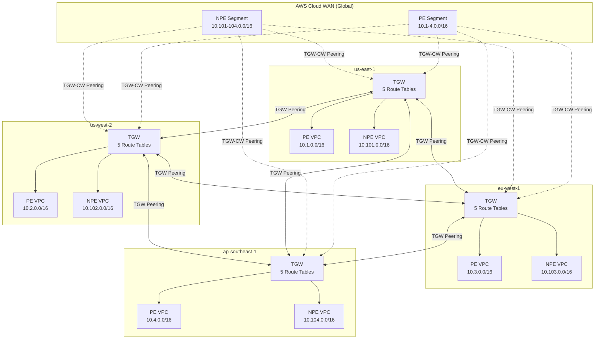
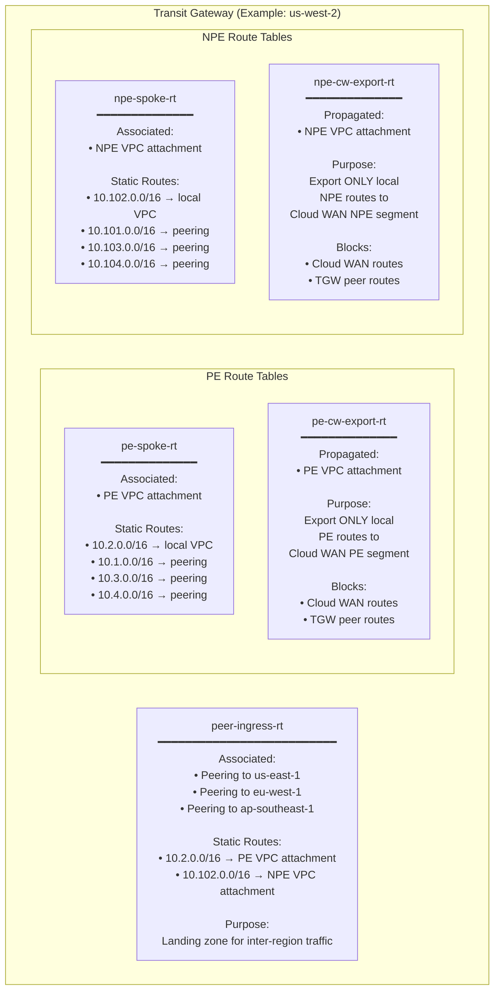
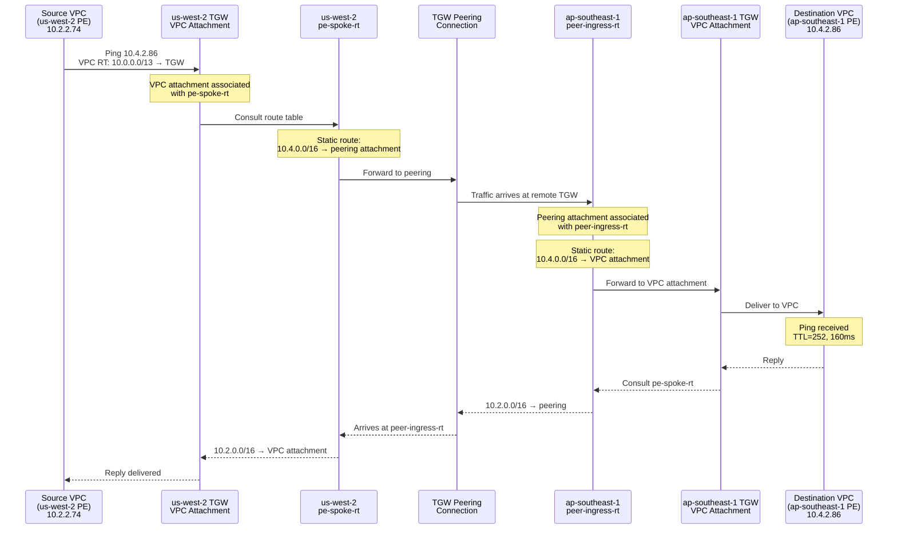
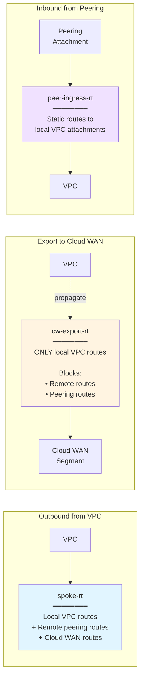
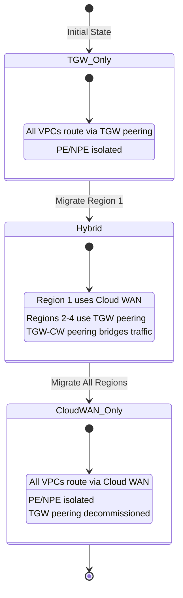

# AWS Cloud WAN Migration Architecture Diagrams

## High-Level Multi-Region Topology

## Per-Region TGW Route Table Architecture

## Traffic Flow: us-west-2 PE → ap-southeast-1 PE

## Route Table Isolation Model

## Migration States

